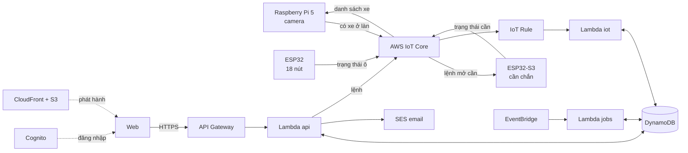

# Kiến trúc hệ thống

## Tổng quan

Hệ thống gồm ba phần:

- Thiết bị tại bãi: Raspberry Pi 5 có camera, ESP32-S3 điều khiển cần chắn, ESP32 đọc 18 nút.
- Đám mây AWS: nhận tin nhắn từ thiết bị, xử lý nghiệp vụ, lưu dữ liệu, gửi lệnh mở cần.
- Ứng dụng web: sơ đồ bãi, màn hình QR ở cổng, trang của khách và trang quản trị.

Nguyên tắc chính: thiết bị chỉ báo những gì xảy ra ở bãi và làm theo lệnh. Mọi quyết định (cho vào, tính tiền, cho ra) nằm ở đám mây và do nhân viên bấm trên web.



## Các dịch vụ AWS

| Dịch vụ | Dùng để làm gì |
|---|---|
| IoT Core | Nhận và gửi tin nhắn MQTT với 3 thiết bị. Mỗi thiết bị có chứng chỉ riêng |
| IoT Rule | Chuyển tin nhắn từ thiết bị sang Lambda `iot` |
| Lambda | 3 hàm: `iot` xử lý tin nhắn thiết bị, `api` phục vụ web, `jobs` chạy giám sát và dọn dữ liệu |
| DynamoDB | 8 bảng: ô, phiên đỗ, biển số trong bãi, email ghi nhớ, tin đã xử lý, thiết bị, bảng giá, cảnh báo |
| API Gateway | Cửa vào của API cho web, kiểm tra đăng nhập |
| Cognito | Tài khoản `admin` và `kiosk` |
| SES | Gửi email hướng dẫn cho khách |
| S3 + CloudFront | Phát hành web qua HTTPS |
| EventBridge | Chạy giám sát mỗi phút, dọn dữ liệu mỗi giờ |
| CloudWatch Logs | Log của Lambda, giữ 7 ngày |
| Budgets | Cảnh báo khi chi phí tháng vượt 5 USD |

Toàn bộ khai báo trong `infra/aws/template.yaml` và dựng bằng AWS CLI.

## Phiên đỗ

Mỗi lượt xe là một phiên đỗ, đi qua các trạng thái:

```text
camera thấy xe ở làn vào -> ENTRY_PENDING (chờ cho vào)
    nhân viên bấm Cho vào     -> PARKED (đang đỗ), mở cần vào
    nhân viên bấm Không cho vào -> REJECTED
camera thấy xe ở làn ra   -> EXIT_REQUESTED (chờ cho ra), chốt số tiền
    nhân viên bấm Cho ra (sau khi thu tiền nếu có phí) -> CLOSED, mở cần ra
```

Xe nằm trong danh sách xe trong bãi khi phiên ở trạng thái `PARKED` hoặc `EXIT_REQUESTED`. Danh sách này hiện ở trang Tổng quan và trên trang camera của Pi. Danh sách chỉ đổi khi nhân viên bấm.

## Biển số demo

Camera chỉ biết có xe hay không, không đọc biển số. Vì vậy đám mây tự cấp biển số demo:

- Xe vào nhận số nhỏ nhất chưa dùng: 11111, 22222, 33333, ... Từ xe thứ 10 thì lặp 3 lần, ví dụ 101010.
- Xe ra là xe có số lớn nhất đang đỗ.

## Ô đỗ và chỉ đường

18 nút trên sa bàn giả lập cảm biến có xe. Trạng thái ô chỉ dùng để biết chỗ nào trống, không gắn với phiên đỗ hay tiền.

Hệ thống không giữ ô cho xe nào. Trang của khách gợi ý ô trống gần cổng nhất lúc khách xem, và cho chọn ô khác. Đường đi vẽ từ cổng vào, đi theo lối chính bên trái, rẽ vào lối của hàng rồi tới ô. Ô ở tầng 2 thì đi hết lối C, lên dốc rồi đi tiếp. Chi tiết ở [parking-layout.md](parking-layout.md).

Nếu bo mạch 18 nút mất kết nối quá 90 giây, mọi ô thành "không rõ". Xe vẫn được cho vào, chỉ là không có ô gợi ý. Bãi chỉ bị coi là đầy khi bo mạch đang kết nối và cả 18 ô đều có xe.

## Mã QR và email

- Khi nhân viên cho xe vào, hệ thống tạo link `/s/<mã>` cho mã QR. Link có chữ ký và hết hạn sau 15 phút, không chứa biển số hay email.
- Khách có thể nhập email để nhận hướng dẫn. Mỗi phiên chỉ gửi một email.
- Khách có thể tích "Ghi nhớ email cho biển số xe này". Lần sau xe đó được cho vào, hệ thống tự gửi email, không cần quét QR. Mỗi email tự gửi có link hủy. Trang QR cũng có nút bỏ liên kết.

Lưu ý khi demo: biển số demo được dùng lại cho xe sau. Nếu đã ghi nhớ email cho 11111 thì xe sau nhận số 11111 cũng được gửi email. Bỏ liên kết sau khi thử.

## Tính tiền

Dưới 15 phút miễn phí. Từ 15 đến 60 phút: 10.000 đ. Mỗi giờ sau đó cộng thêm 5.000 đ. Bảng giá sửa được trên trang quản trị. Số tiền được chốt lúc camera thấy xe ở làn ra.

Cần ra không tự mở, kể cả khi miễn phí. Nhân viên thu tiền mặt (hoặc bấm Miễn phí và ghi lý do) rồi bấm Cho ra.

## Dữ liệu cá nhân

- Biển số và email của mỗi phiên bị xóa sau tối đa 10 ngày. Tác vụ dọn dữ liệu chạy mỗi giờ.
- Email mà khách tự chọn ghi nhớ thì giữ tới khi khách hủy.
- Log không ghi biển số, email.
- Pi xử lý ảnh trong bộ nhớ, không gửi ảnh lên mạng.

## Giới hạn

- Camera không đọc biển số; xe ra luôn là xe số lớn nhất.
- 18 ô dùng nút nhấn, chưa phải cảm biến thật.
- Không có cảm biến xe qua cổng nên mọi lượt vào, ra đều cần nhân viên bấm.
- SES đang ở chế độ thử, chỉ gửi được tới email đã xác minh.
