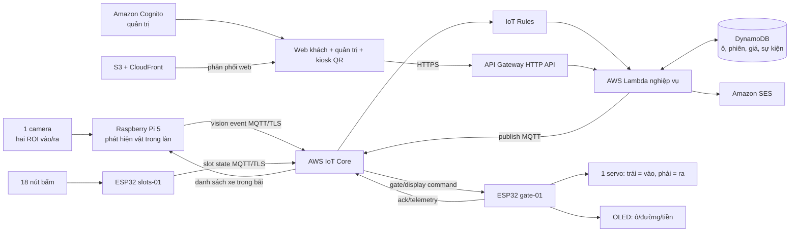

# Kiến trúc hệ thống Smart Parking

Tài liệu này chốt thiết kế **MVP đồ án**. Sơ đồ bãi ở [parking-layout.md](parking-layout.md), nghiệp vụ ở [use-cases.md](use-cases.md), giao thức ở [mqtt-contract.md](mqtt-contract.md) và [api-contract.md](api-contract.md).

## 1. Quy mô và quyết định chính

- Một bãi mô hình **2 tầng × 3 hàng × 3 ô = 18 ô**. ID ô: `F1-A1` đến `F2-C3`.
- Một Raspberry Pi 5 và một camera nhìn được **hai vùng làn vào/ra** (nửa trái = VÀO, nửa phải = RA). Bản demo không dùng thẻ màu hay biển in: Pi so khung hình với ảnh nền trống, thấy vật (tay/xe mô hình) che vào vùng làn là báo **có xe**. Backend tự đánh **biển số demo** `11111`, `22222`, … (số nhỏ nhất chưa dùng); xe ra là xe có số lớn nhất đang đỗ.
- **Mọi lượt vào/ra đều chờ quản trị cho phép** trên trang Phiên đỗ: bấm *Cho vào* thì mở cần vào và xe vào danh sách trong bãi; bấm *Cho ra* (sau khi thu tiền nếu có phí) thì mở cần ra và xe rời danh sách.
- Một ESP32-S3 `gate-01` điều khiển **một servo/cần chắn 3 vị trí** (thẳng = đóng, trái = mở vào, phải = mở ra) và một OLED chỉ dẫn (tuỳ chọn).
- Một ESP32 `slots-01` đọc **18 nút bấm**, mỗi nút đại diện một ô. Mỗi lần bấm đảo trạng thái trống/có xe của một ô; trạng thái giả lập được lưu vào NVS. **Ô chỉ dùng để chỉ chỗ trống**: hệ thống không gán ô cho xe, không liên quan phiên hay tiền.
- Một web app responsive dùng chung. Khách xem sơ đồ công khai và trang chỉ dẫn theo QR phiên; quản trị đăng nhập để xem biển số, phiên đỗ, tính phí và điều khiển thủ công.
- **Email qua Amazon SES** là kênh thông báo của MVP. Khách nhập email trên trang QR của lượt; **tùy chọn** ghi nhớ email cho biển số để lần sau xe vào được tự gửi chỉ dẫn, hủy bằng link trong email. Không cần tài khoản khách.
- Tính phí theo bảng giá mô phỏng, xác nhận thu tiền thủ công. Không tích hợp cổng thanh toán trong MVP.
- Dữ liệu định danh gồm biển số, email và ảnh nếu bật lưu ảnh có hạn truy cập **10 ngày kể từ khi thu thập**; job dọn chạy theo giờ để xóa vật lý quanh mốc này. Demo mặc định không lưu ảnh lên cloud.

## 2. Sơ đồ đầu cuối



**Kết nối internet:** hai ESP32 dùng Wi-Fi (ví dụ `UET-Wifi-T3 2.4Ghz`, mạng mở); Pi phát điểm Wi-Fi riêng cho dự án khác nên lên mạng qua **dây LAN nối laptop** (laptop chia sẻ Internet, xem [setup-guide](setup-guide.md)); mỗi thiết bị có AWS IoT Thing, certificate và policy riêng. Thiết bị không gọi trực tiếp SES/DynamoDB. Chỉ backend/Lambda phát lệnh điều khiển.

**Kiosk QR:** mở web app ở chế độ kiosk trên laptop/tablet có sẵn hoặc màn hình HDMI gắn Pi. Web hiển thị QR riêng cho phiên vừa được cho vào, kèm bản đồ đường đi tới ô trống gợi ý. OLED 128×64 trên ESP32 chỉ hiện chữ ngắn, không dùng làm nơi quét QR.

## 3. Thành phần phần mềm

| Thành phần | Chạy ở đâu | Chức năng |
|---|---|---|
| Vision service | Pi 5 | Chụp khung hình, phân vùng hai làn, phát hiện vật bằng so nền, báo một lần mỗi lượt; hiển thị danh sách xe backend gửi xuống |
| Gate firmware | ESP32 `gate-01` | Nhận lệnh có hạn, ánh xạ lệnh ENTRY/EXIT vào 1 servo 3 vị trí, cập nhật OLED, gửi ACK/trạng thái |
| Slot firmware | ESP32 `slots-01` | Đọc 18 nút nối thẳng GPIO (pull-up trong chip); debounce; phát thay đổi/snapshot |
| Business service | Lambda | Dedupe sự kiện, đánh biển demo, tạo lượt chờ vào/chờ ra, tính phí, phát lệnh cần, gợi ý ô trống, tạo QR token, gọi SES, gửi danh sách xe cho Pi |
| Public web | S3 + CloudFront | Sơ đồ 18 ô; trang QR phiên: chọn ô trống trên bản đồ, vẽ đường đi từ cổng, nhập email (tùy chọn ghi nhớ) |
| Admin web | Cùng web app | Danh sách xe trong bãi, nút Cho vào / Cho ra (mở cần), thu tiền, cảnh báo, thiết bị, bảng giá |
| API | API Gateway HTTP API + Lambda | REST cho web; xác thực admin và token QR |
| Database | DynamoDB | Ô, phiên đỗ, cấu hình giá, event id/command id đã xử lý, liên kết biển số ↔ email (khách tự chọn) |
| Quan sát/chi phí | CloudWatch + AWS Budgets | Log lỗi và cảnh báo chi phí |

**AWS tối thiểu để demo:** IoT Core, IoT Rules, Lambda, API Gateway, DynamoDB, SES, S3/CloudFront cho web, Cognito cho admin/kiosk, EventBridge Scheduler cho việc dọn dữ liệu, CloudWatch và Budgets. RDS, SQS, EventBridge event bus, Rekognition và SMS là **mở rộng có điều kiện**, không cần triển khai để đạt các use case MVP. DOCX gốc liệt kê nhiều dịch vụ và mức Free Tier; mức này thay đổi theo thời điểm/vùng, nên không coi đó là cam kết chi phí.

## 4. Nguồn sự thật và trạng thái

| Dữ liệu | Nguồn sự thật | Ghi chú |
|---|---|---|
| Có xe ở làn vào/ra | Pi event | Chỉ là yêu cầu; quản trị quyết định cho vào/ra |
| Biển số demo | Backend | Số nhỏ nhất chưa dùng khi vào; số lớn nhất đang đỗ khi ra |
| Danh sách xe trong bãi | Backend (phiên `PARKED`/`EXIT_REQUESTED`) | Web Tổng quan và trang camera Pi cùng hiển thị; Pi nhận qua MQTT |
| Trạng thái có xe tại ô | ESP32 slots (nút bấm) | Chỉ để chỉ chỗ trống; sau 90 giây không có snapshot → `UNKNOWN` |
| Trạng thái cần chắn | ESP32 gate telemetry | Lệnh đã gửi chưa có nghĩa cơ cấu đã mở |
| Phí/đã thu tiền | Backend + thao tác quản trị | Phí demo, không xác thực thanh toán ngân hàng |

Trạng thái phiên:

```text
camera thấy xe ở làn VÀO → ENTRY_PENDING ──(Cho vào: mở cần vào)──→ PARKED
                                          └─(Không cho vào)────────→ REJECTED
camera thấy xe ở làn RA  → PARKED → EXIT_REQUESTED (khóa phí) ──(Cho ra: mở cần ra)──→ CLOSED
```

Trạng thái ô: `AVAILABLE`, `OCCUPIED`, `UNKNOWN`, `OUT_OF_SERVICE`. Ô không bị giữ cho xe nào. Bãi chỉ bị coi là đầy khi board ô đang online và báo không còn ô trống; board ô offline thì xe vẫn được cho vào, chỉ không có gợi ý ô.

## 5. Gợi ý ô và đường đi

Lối đi ở [parking-layout.md](parking-layout.md): cổng vào ở góc trái trên, lối chính chạy dọc bên trái, mỗi hàng A/B/C có lối đi ngang ngay dưới hàng ô, cuối lối C là ram lên tầng 2. Gợi ý = ô `AVAILABLE` gần cổng nhất **tại thời điểm xem** (tầng 1 trước, hàng A → B → C, cột 1 → 3, rồi tầng 2). Trang QR cho khách **chạm chọn ô trống khác**; web vẽ đường đi từ cổng vào tới ô, ô tầng 2 có bước "lên ram". OLED hiện ô gợi ý và số chỗ trống. Email ghi đường tới ô khách chọn (hoặc ô gợi ý).

## 6. Email và QR

1. Quản trị bấm *Cho vào* → backend tạo `claim_nonce` ngẫu nhiên ít nhất 128 bit, ký token QR bằng HMAC với hạn 15 phút. Kiosk lấy URL HTTPS `/s/{token}` từ API và hiển thị QR lớn kèm bản đồ đường đi; raw token không lưu trong database.
2. Khách quét QR, chọn ô và xem đường đi, có thể nhập email và đồng ý nhận email hướng dẫn của lượt này. Form không yêu cầu tài khoản hoặc biển số.
3. **Tùy chọn ghi nhớ:** khách tích "Ghi nhớ email cho biển số xe này" → lưu liên kết biển số ↔ email. Lần sau xe đó được cho vào, backend **tự gửi email chỉ dẫn** (kèm link bản đồ), không cần quét QR. Mỗi email tự gửi có link **Hủy liên kết** (`/huy-email/{token}` ký HMAC); trang QR có nút *Bỏ liên kết email*.
4. API giới hạn một email hướng dẫn mỗi phiên. Không nhập email: OLED và kiosk vẫn chỉ đường; không gửi thư.

Link QR không chứa biển số/email. Trang QR chỉ hiện email đã che bớt (`kh***@gmail.com`). **Lưu ý demo:** biển số demo được dùng lại (xe `11111` ra thì xe vào sau lại nhận `11111`), nên email đã liên kết với biển demo sẽ gửi cho lượt sau; bỏ liên kết sau khi thử.

## 7. Tính phí và kết thúc phiên

Bảng giá ví dụ để demo (sửa được trong admin): dưới 15 phút: 0 ₫; đến 60 phút: 10.000 ₫; mỗi giờ tiếp theo bắt đầu: +5.000 ₫. Camera thấy xe ở làn ra → backend lấy thời điểm đó làm `charge_end_at` để khóa số tiền, phiên sang `EXIT_REQUESTED` và trang Phiên đỗ hiện phí. Cần ra **không tự mở**, kể cả khi miễn phí: phiên 0 ₫ có nút *Cho ra*; phiên có phí cần ghi nhận `PAID_CASH` hoặc `WAIVED` (có lý do) rồi mới mở cần. Bấm xong, phiên `CLOSED` ngay và xe rời danh sách. Ô về `AVAILABLE` khi nút ô được bấm lại.

## 8. Lưu dữ liệu và bảo vệ truy cập

- Pi xử lý khung hình trong RAM; mặc định không upload ảnh. Biển số chuẩn hóa, email, token QR và sự kiện nhận diện có hạn truy cập tối đa 10 ngày tính từ lúc thu thập. Xóa email/token khi phiên đóng nếu không cần tra cứu.
- Job purge chạy mỗi giờ, ưu tiên xóa dữ liệu từ mốc 9 ngày 23 giờ để có dư địa trước hạn 10 ngày; báo lỗi nếu job thất bại. DynamoDB TTL chỉ dùng cho item có thể xóa toàn bộ; Lambda xóa riêng thuộc tính định danh khỏi phiên cần giữ số liệu phí. API từ chối đọc dữ liệu quá hạn ngay tại mốc 10 ngày vì TTL có thể xóa trễ.
- Bản ghi tài chính còn cần cho báo cáo được giữ dưới dạng **không có biển số, email, ảnh hoặc token**.
- Khách chỉ thấy sơ đồ chung và dữ liệu phiên trong token của mình; quản trị đăng nhập Cognito. IoT certificate và IAM role cấp quyền tối thiểu. Không commit khóa, certificate hoặc email thật.

## 9. Giới hạn cần trình bày trong demo

- Một camera cho hai làn chỉ khả thi nếu bố trí góc nhìn, ánh sáng và độ phân giải biển số đạt yêu cầu. Nếu không đạt, demo từng làn theo lượt và giữ nguyên schema `lane_id`; bổ sung camera là nâng cấp sau.
- 18 ô do nút bấm mô phỏng không chứng minh được phát hiện xe ngoài thực tế.
- Camera demo chỉ phát hiện "có vật" trong làn, không đọc biển; biển số là số demo do backend đánh, xe ra luôn là xe số lớn nhất.
- OLED hiển thị chỉ dẫn ngắn; QR cần màn hình kiosk lớn hơn. Kiosk có thể là laptop/tablet sẵn có.
- Không có cảm biến qua cổng: quản trị quyết định cho vào/cho ra trên web.

## Tài liệu AWS

- [AWS IoT Core và MQTT](https://docs.aws.amazon.com/iot/latest/developerguide/mqtt.html)
- [Amazon SES: gửi bằng API](https://docs.aws.amazon.com/ses/latest/dg/send-email-api.html)
- [Amazon SES: điều kiện sandbox](https://docs.aws.amazon.com/ses/latest/dg/request-production-access.html)
- [DynamoDB TTL](https://docs.aws.amazon.com/amazondynamodb/latest/developerguide/TTL.html)
